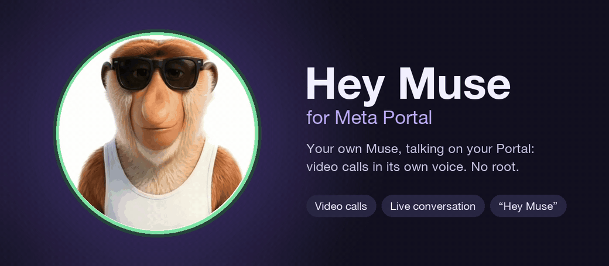
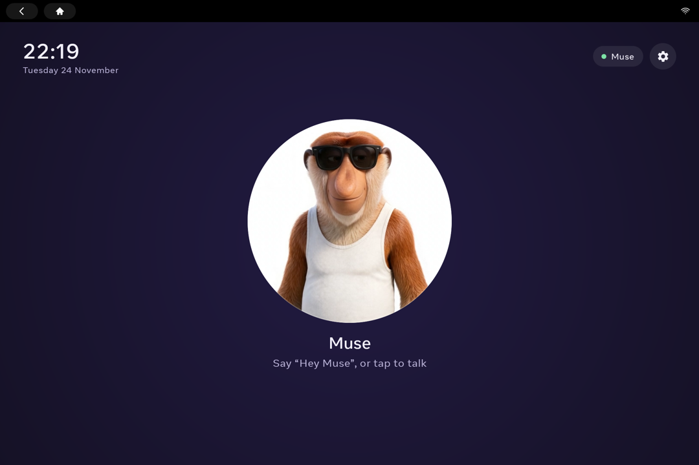
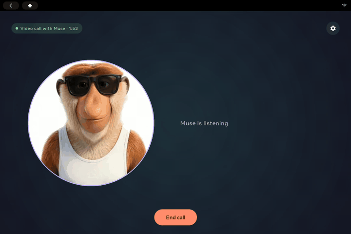
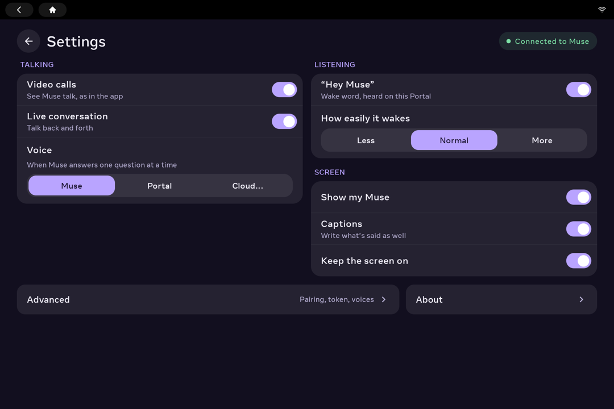
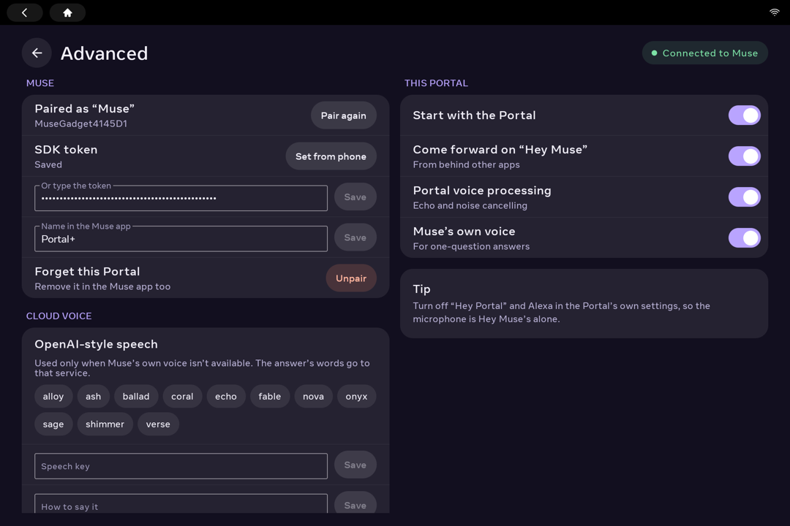

# Hey Muse for Portal

<p align="center">
  
</p>

A Meta Portal that answers as [Muse](https://gadgets.muse.ai), Meta's AI agent. Say "Hey Muse" and
talk: your own Muse answers in its own voice, and in a video call its avatar talks on the Portal's
screen, as in the Muse app.

It is an ordinary app that runs alongside Portal OS: **no root and no firmware changes**. The Portal
pairs with the Muse app like any Muse gadget, over its own Bluetooth.

This is a fork of [hey-muse](https://github.com/wobsoriano/hey-muse), which made an Echo Show 5 answer
as Muse by replacing its whole operating system ([TECHO5](https://github.com/HuskerMinion/techo5)).
Here all of that is gone and only the app is left: hey-muse's Muse client, pairing, wake word and
voice, built into an Android app the way [Wormhole Display](https://github.com/pgodlews/wormhole-display)
is.

<table>
  <tr>
    <td width="50%"><br><sub><b>Waiting</b>: your Muse, as the Muse app shows it</sub></td>
    <td width="50%"><br><sub><b>Video call</b>: Muse talks on screen, in its own voice</sub></td>
  </tr>
  <tr>
    <td width="50%"><br><sub><b>Settings</b>: the few things you change, in big rows</sub></td>
    <td width="50%"><br><sub><b>Advanced</b>: pairing, the token, cloud voices, the Portal's switches</sub></td>
  </tr>
</table>

> **Tested with live Muse** on a Portal+ (Gen 2) in the UK, November 2026: pairing, voice calls,
> video calls and Muse's own voice. See [What was tested](#what-was-tested).
>
> **Not made by Meta.** This is a hobby project. Meta did not make it and does not endorse it. Muse
> and Portal are Meta's. Using Muse this way is covered by Meta's
> [Gadget SDK Terms](https://gadgets.muse.ai/sdk-terms).

## What it does

- **"Hey Muse", or a tap.** The wake word is heard on the Portal itself; a tap anywhere works too.
- **A video call with your Muse.** By default "Hey Muse" starts a call in which Muse's avatar talks
  on screen in Muse's own voice, as in the Muse app. Saying goodbye, or **End call**, hangs up.
- **Or a live voice call,** when video is off or Muse won't take one: you talk back and forth, see
  what was said, and can cut Muse off.
- **Or one question at a time,** when Muse won't take a call: the answer comes in Muse's own voice,
  or in a built-in voice (SVOX Pico) that needs no key, or in a cloud voice from an OpenAI-style
  speech endpoint.
- **A follow-up without the wake word** when Muse's answer is a question.
- **Things Muse can do on the Portal:** set timers and alarms, list and cancel them, change the
  volume, and stop a ring. Muse decides when to call them; nothing else on the Portal is reachable.
- **Pairs over the Portal's own Bluetooth** with the Muse app. The Portal then shows up in the Muse
  app's device list.
- **Keeps listening in the background,** starts when the Portal starts, brings itself to the front
  and requests system-wide audio focus when it hears "Hey Muse" (muting/ducking background media),
  and automatically returns to the background after 10 seconds of idle inactivity.
- **Your Muse on the screen,** as you made it in the Muse app: its picture and the app's animations
  (idle, working, waiting), fetched from your own Muse and kept only on your Portal.
- **Fits every Portal:** sizes follow the screen, so the same app works on a Portal+, Portal, Portal
  Go and Mini.

Smart home control is not part of this: reaching your lights is Muse's own business, for example
through [Muse Home Link](https://gadgets.muse.ai/home-link).

## What you need

- A Meta Portal: Portal+ (Gen 1 or 2), Portal, Portal Mini or Portal Go. All of them are 64-bit ARM
  on Android 9 or 10. The Portal TV may work but has not been thought about.
- ADB access to the Portal. Follow Meta's
  [Set up your device](https://developers.meta.com/horizon/documentation/android-apps/portal-setup/)
  to turn it on, and install Google's
  [platform tools](https://developer.android.com/tools/releases/platform-tools) for `adb`.
- A Muse subscription, the Muse app on your phone, and an SDK token of your own from
  [gadgets.muse.ai](https://gadgets.muse.ai/settings/sdk-tokens) (Account → SDK tokens). It starts
  with `mgst_`. The token is personal: never publish it, and do not share it with another household.
- Optional: a key for an OpenAI-style speech endpoint, for a more natural voice.

## Install

There are no releases yet. Download the APK from the **Actions** tab: open the newest successful
**Build & Release** run on `muse`, download the `hey-muse-…` artifact at the bottom, and unzip it to
get `hey-muse.apk`. Then:

```sh
adb install -r -g hey-muse.apk
```

`-g` grants the microphone up front; without it the app asks on first launch.

The easiest way to configure your SDK token and cloud voice settings is from your phone:
1. Open **Settings** (gear icon at the top right) and tap **📱 Phone Setup** (or **Configure from Phone (Scan QR)**).
2. Scan the displayed QR code with your phone camera.
3. Paste your SDK token and speech key in the phone's browser form and tap **Save to Portal**.

Alternatively, hand over your SDK token with adb, which also beats typing it on the Portal's keyboard:

```sh
adb shell am start -n io.github.pgodlews.heymuse/.MainActivity --es sdk_token mgst_your_token_here
```

The same works for `speech_key`, `voice` (`builtin`, or a cloud voice like `coral`), `speech_style`,
`speech_base`, `speech_model` and `display_name`. All of them can also be typed under Settings
(the gear at the top right).

Open **Muse Portal** (the app's name in the Portal's apps list), or start it with
`adb shell am start -n io.github.pgodlews.heymuse/.MainActivity`.

### Free the microphone

The Portal's own assistant has the microphone first. While "Hey Portal" or Alexa is talking, every
other app hears silence, and the app says so ("The microphone hears nothing"). For Hey Muse to hear
you reliably, turn off **"Hey Portal"** and unlink Alexa in the Portal's settings. The privacy
switch silences the microphone the same way.

## Pair with the Muse app

1. In Hey Muse, open **Settings** and make sure the **Muse SDK token** is saved.
2. Press **Pair with the Muse app**. The Portal goes on Bluetooth for 10 minutes under a name like
   `MuseGadgetA1B2C3`, shown in large letters.
3. On your phone, open the Muse app, go to **Settings → Devices** and turn on **Developer mode**.
4. Tap **Add Device** (the **+** at the top right) and pick the `MuseGadget` name.
5. Muse warns that this is a community device. Continue if the Portal is yours.
6. When the app asks for Wi-Fi, pick the one network it shows. The Portal is already online, so no
   password is asked.

The status at the top turns to **Muse · your name**. Say "Hey Muse" and ask something. The pairing
survives restarts, and the Portal reconnects by itself.

Pairing keeps setup secrets from someone who is only listening. It does not prove who the phone is,
so it cannot stop someone in the middle. Pair on a network you trust.

**Unpair** forgets the tokens but keeps the Portal's identity, so pairing again brings it back under
the same name. Muse is not told: also remove the device in the Muse app under Settings → Devices.

## What your voice does

- The wake word is detected on the Portal. Nothing is sent while it waits.
- After the wake word (or a tap), a call starts: until it ends, what the room says streams to your
  Muse, which keeps the conversation in your Muse account. Anyone who speaks to the Portal is heard
  the same way. A call ends when you say goodbye, tap **End call**, or nobody speaks for 45 seconds.
- Without a call, what you say, 60 seconds at most, goes to Muse as a recording, kept on the message
  in your Muse account.
- With a cloud voice, the text of each answer goes to the speech provider (OpenAI unless you set
  another endpoint). With the built-in voice, nothing else leaves the Portal.
- The pairing tokens, the SDK token and the speech key are kept in the app's private storage.

## Settings worth knowing

The first page has what you change day to day: **Video calls**, **Live conversation**, the
**Voice** (Muse's own, the Portal's, or a cloud voice), **“Hey Muse”** and how easily it wakes
(**Less / Normal / More**), **Show my Muse** and **Captions**. Everything technical is under
**Advanced**: pairing, the SDK token, the cloud voice, and the switches below.

- **Portal voice processing** uses the Portal's own beamforming, noise suppression and echo
  cancellation for the microphone. Turn it off if the wake word is often missed.
- **Open on the wake word** brings the app to the front from the background. Android needs
  **Display over other apps** for that; the setting has an **Allow** button.

## Your Muse on screen

With **Show my Muse** on, the app asks your Muse for its avatar (the picture you chose in the Muse
app and the app's short animations) and keeps them in its private storage, checking for changes now
and then. In a video call the circle shows Muse's live picture instead.

Without an avatar the app draws a glowing orb. Another option is Meta's default gadget character,
made from your own checkout of Meta's SDK:

```sh
uv run --with pillow tools/muse-avatar/make_sprites.py --sdk ~/src/muse-gadget-sdk
adb push build/muse-avatar /sdcard/Android/data/io.github.pgodlews.heymuse/files/
```

The character is Meta's: do not publish the pictures. [tools/muse-avatar](tools/muse-avatar/README.md)
has the details.

## What was tested

On a Portal+ (Gen 2, Android 10) with a live Muse account in the UK, November 2026:

- Pairing with the Muse app on an iPhone, after a fix: Android renames Bluetooth asynchronously, and
  advertising straight away sent the Portal's own name, which the Muse app does not list.
- Voice calls in English and Polish, with captions, cutting in, and hanging up by goodbye or tap.
- Video calls: Muse's live picture (H.264, about 22 frames a second) and voice (Opus) over UDP, and
  over TCP when UDP is blocked; calls of a few minutes.
- One question at a time, answered in Muse's own voice (an MP3 Muse makes for the reply).
- The owner's avatar and its animations, fetched from Muse.
- `go test -race ./...` in `core/` passes, including SRTP test vectors from RFC 3711 and from the SDK.

Not yet tried: Portal Go, Portal Mini, Portal TV, and full duplex (talking over Muse).

## Troubleshooting

**"Microphone hears nothing".** The privacy switch is on, or Portal's own assistant has the
microphone. See [Free the microphone](#free-the-microphone).

**Pairing does not start, "Bluetooth refused to advertise".** Turn Bluetooth on in the Portal's
settings (or `adb shell cmd bluetooth enable`) and try again. If the Portal's Bluetooth cannot
advertise at all, pair from a computer instead: see [AGENTS.md](AGENTS.md#pairing-without-the-portals-bluetooth).

**"Paired as ..., but not connected".** The app keeps trying; the reason follows the colon, and
`adb logcat -s HeyMuseCore` has the rest.

**The pairing was revoked.** When Muse refuses the Portal's tokens outright (for example after you
remove it in the Muse app), the app forgets them and goes back to **Not paired**. Pair again.

## Building

Requirements: JDK 17, Go 1.26, the Android SDK (`ANDROID_HOME`) with NDK 27.3.13750724 and CMake
3.22.1.

```sh
./scripts/build.sh            # dist/hey-muse.apk
adb install -r -g dist/hey-muse.apk
```

The Gradle build compiles the Go core into `app/libs/heymuse-core.aar` with gomobile
(`scripts/build-core.sh`, which installs gomobile itself). [AGENTS.md](AGENTS.md) explains the layout.

## Credits

- [hey-muse](https://github.com/wobsoriano/hey-muse), whose Muse client, pairing, wake word and voice
  this is, and [portal-muse](https://github.com/wobsoriano/portal-muse), whose notes on calls and on
  the Portal pointed the way, built on [TECHO5](https://github.com/HuskerMinion/techo5) by HuskerMinion and EchoLocal by
  Yuri Gelfand. MIT.
- Meta's [Muse Gadget SDK](https://github.com/facebookincubator/muse-gadget-sdk), Apache 2.0. The Muse
  client and the pairing code are ports of it.
- [zserge/microwakeword](https://github.com/zserge/microwakeword), MIT, which runs the wake word.
- SVOX Pico, Apache 2.0, for the built-in voice. Home Assistant Voice sounds, CC BY 4.0, for the chime.

[NOTICE](NOTICE) lists everything and its license.

## License

MIT, as hey-muse and TECHO5 are. See [LICENSE](LICENSE) and [NOTICE](NOTICE).
